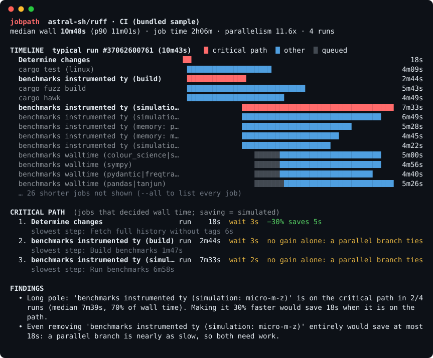

# jobpath

**Your CI has 40 jobs, but only a few of them decide how long you wait. jobpath finds them.**

[](https://github.com/Nithinfgs/jobpath/actions/workflows/ci.yml)
[](LICENSE)


<p align="center">
  
</p>

<sub>Real output from [astral-sh/ruff](https://github.com/astral-sh/ruff)'s CI (recorded runs bundled with the tool). Try it yourself: `jobpath --demo`.</sub>

## In 20 seconds

GitHub Actions runs your jobs in parallel, so wall-clock time is set by the **longest chain of dependent jobs**, the *critical path*. Making any job that is *not* on that path faster saves you nothing.

jobpath reads the timing data GitHub already records for your runs, and tells you:

- **which jobs are on the critical path**, and how often across your last N runs;
- **where that time goes**: waiting in queue, runner setup, checkout, toolchain installs, caches, dependency installs, or real work;
- **what a speed-up is actually worth**: it re-simulates the run to answer "if this job were 30% faster, how much sooner does CI finish?" (often much less than you'd hope, because a parallel branch takes over).

No agent, no workflow changes, no account, no dependencies. It only reads from the GitHub API.

## Quick start

```bash
pipx install git+https://github.com/Nithinfgs/jobpath     # or: uvx --from git+https://github.com/Nithinfgs/jobpath jobpath --demo

jobpath --demo                          # bundled real sample, no network, no token
jobpath your-org/your-repo -w ci.yml    # last 10 successful runs of a workflow
jobpath your-org/your-repo              # lists the workflows if there is more than one
jobpath https://github.com/o/r/actions/runs/123456   # a single run
```

Run it inside a clone and the repository is taken from `origin`. Public repositories work without a
token (at GitHub's low anonymous rate limit); for private repos or heavier use set `GITHUB_TOKEN`, or
just run `gh auth login`, and jobpath picks the token up from the `gh` CLI. A token with `actions: read`
is enough.

## What you get

| | |
|---|---|
| **Timeline** | Gantt of a typical run (closest to median wall time). Critical path in red, queue time shaded. |
| **Critical path** | Each job on it with run time, wait time, slowest step, and a simulated saving. |
| **Where the time goes** | Critical-path seconds split into queue, runner, checkout, toolchain, cache, deps, artifacts, work. |
| **Jobs by impact** | Across N runs: how often each job is on the path, median / p90 duration, expected saving. |
| **Findings** | Plain-language notes: the long pole, queue-bound paths, setup tax, high variance. |
| **Exports** | `-f md` (with a Mermaid Gantt, ready for `$GITHUB_STEP_SUMMARY`), `-f json`, `-f html` (standalone). |

```bash
jobpath o/r -w ci.yml -f md >> "$GITHUB_STEP_SUMMARY"    # report in the run summary
jobpath o/r -w ci.yml -f html -o report.html             # shareable page
jobpath o/r -w ci.yml --budget 10m                       # exit 1 if median wall time exceeds 10 minutes
jobpath o/r -w ci.yml --save runs.json                   # keep the raw data...
jobpath --file runs.json                                 # ...and re-analyse offline
```

To get a report on every CI run, copy [`examples/jobpath-summary.yml`](examples/jobpath-summary.yml) into
`.github/workflows/`. This repository does exactly that for itself.

## Why this exists

Tools that report per-job averages tell you which job is *slow*. They don't tell you which job *matters*.
Speeding up a 6-minute job that runs beside an 8-minute one is wasted effort, while shaving the 3-minute
job that every other job waits for pays off on every run. Finding that out by reading a Gantt chart in the
Actions UI works for five jobs and fails for fifty. The same question comes up whenever someone says
"CI got slow": is it the tests, the queue, or the setup repeated in every job?

## How it works

The Actions API exposes each job's `created_at`, `started_at` and `completed_at`, but not the `needs:` graph.
A job is created at the moment its last dependency finishes, so the jobs that completed just before a job's
`created_at` are its dependencies. That is enough to:

1. **Rebuild the dependency graph** from timestamps (jobs created within a few seconds of another job's
   completion are its dependents; the tolerance is `--tolerance`).
2. **Walk back from the last job to finish** through the dependency that finished latest: the critical path.
   The path's wait + run times add up exactly to the run's wall time.
3. **Classify steps** (`Set up job`, `actions/checkout`, `setup-*`, `npm ci`, caches, artifacts, everything
   else is work) to show what the path is spent on.
4. **Re-simulate the run** with one job sped up (or removed), keeping every other job's duration and
   scheduling latency fixed, and report the change in wall time.

### Limitations (please read)

- The graph is **inferred**, not read from your workflow file. When several jobs finish in the same second,
  timestamps cannot say which one gated a dependent. jobpath then reports savings as a **range** (lower
  bound: every co-finisher gates; upper bound: only the last one does) and says when it could not link a job
  at all. Parsing `needs:` to remove this ambiguity is on the roadmap.
- Savings are a **simulation**, not a measurement. They assume the other jobs don't change.
- Only successful runs are analysed, and only the latest attempt of each run.
- Queue time and runner contention are shown as observed; jobpath can't tell you *why* a runner was busy.
- github.com only (no GitHub Enterprise Server yet).

## Configuration

jobpath has no config file; everything is a flag.

| Flag | Meaning |
|---|---|
| `-w, --workflow` | Workflow file or id (`ci.yml`). |
| `-n, --runs` | Successful runs to analyse (default 10). |
| `--branch`, `--event` | Filter runs, e.g. `--branch main --event push`. |
| `-f, --format` | `term` (default), `md`, `json`, `html`. |
| `-o, --output` | Write to a file instead of stdout. |
| `--top N`, `--all` | Rows in the terminal timeline. |
| `--tolerance SEC` | Max gap between a job finishing and its dependent being created (default 5). |
| `--budget DUR` | Exit 1 if the median wall time exceeds `DUR` (`90s`, `12m`, `1h30m`). |
| `--save`, `--file`, `--demo` | Offline workflows. |
| `--color`, `--no-color` | Force or disable ANSI (`NO_COLOR` is honoured). |

## Roadmap

- [ ] Read `needs:` from the workflow file at the run's commit to resolve timestamp ties exactly
- [ ] `jobpath diff`: compare two branches or two time ranges ("what made CI slower this week?")
- [ ] Cache hit/miss detection from cache step output
- [ ] Billable-minute view (cost, not just wall time)
- [ ] GitHub Enterprise Server support (`--api-url`)
- [ ] PyPI release (`pip install jobpath`) and a reusable GitHub Action

Ideas and recorded runs where the path looks wrong are the most useful contributions; see
[CONTRIBUTING.md](CONTRIBUTING.md).

## Development

```bash
pip install -e ".[dev]"
pytest && ruff check . && ruff format --check . && mypy
python scripts/make_demo_svg.py > docs/assets/demo.svg    # regenerate the hero image from real output
```

The bundled sample (`src/jobpath/data/ruff-ci.json`) is a trimmed recording of four public runs of
astral-sh/ruff's CI workflow: job and step names and timestamps only.

## License

[MIT](LICENSE)
